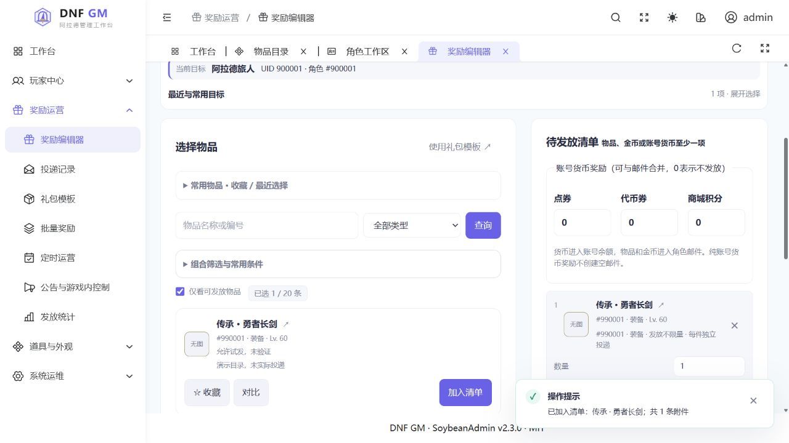
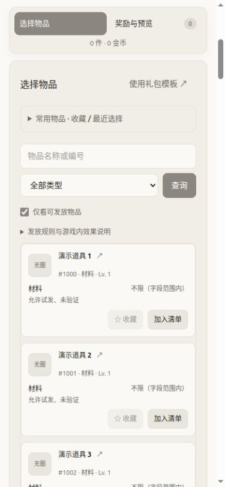
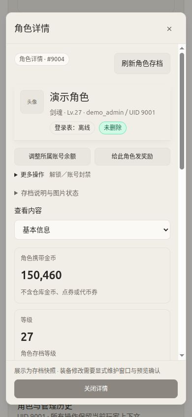

<div align="center">

# llnut DNF GM

**为 llnut/dnf 清风 1031 适配的轻量中文 GM 控制台**

玩家查询 · 图标选物 · 邮件奖励 · 角色维护 · 运营与审计

[](https://github.com/Wuse777/llnut-dnf-gm/releases)
[](LICENSE)


[界面展示](#界面展示) · [功能一览](#功能一览) · [部署指南](docs/DEPLOYMENT.md) · [文档中心](docs/README.md) · [更新记录](CHANGELOG.md)

</div>



> **截图说明**：当前源码的真实前端界面，使用本地合成 API、演示角色与虚构物品；不是生产玩家数据，也不是游戏内效果证明。缺图位置如实显示占位，不附带 DNF 游戏素材。[更多界面与截图来源 →](docs/SCREENSHOTS.md)

## 项目简介

把账号查询、奖励发放和受控维护放进一个可追踪的中文工作台：先选定玩家，预览变更，再确认执行；遇到响应中断，按原操作编号查询，而不是重复发放。

- **真实图标选物**：匹配客户端离线解析与 PVF 绑定；已验证样本覆盖 66,450／66,456 项，缺图状态、职业插画出处和鉴权保持明确。游戏素材需部署者自行提供。
- **面向日常使用**：CPAMC 风格主题、桌面双栏与手机卡片、紧凑目标区、就近错误提示、角色上下文快捷操作。
- **奖励流程完整**：点券／代币券／商城积分、物品与金币邮件、版本化礼包、批量任务、定时运营和投递记录。
- **维护边界明确**：存档类修改通过显式维护窗口；不可变快照、幂等记录与审计保留历史，不把数据库成功写成游戏效果已验收。
- **部署保持克制**：FastAPI 单进程、最多 3 个数据库连接；前端在维护电脑构建，游戏数据库不暴露公网。

> [!IMPORTANT]
> 这是**非官方、特定镜像适配项目**，不是通用 DNF GM，也不是游戏整合包。你需要已有且有权管理的 llnut/dnf 服务端、自行准备的私有配置及匹配 PVF。更换镜像、PVF 或数据库结构必须重新适配。公开仓库不含服务端、客户端、PVF、NPK、真实物品索引、玩家数据或管理员凭据。

## 界面展示

| 手机选物：卡片与固定工作区切换 | 手机角色：主要动作与信息优先 |
| :---: | :---: |
|  |  |
| 名称、编号、状态与加入按钮同时可见 | 余额、奖励直接操作；解锁／封禁收进“更多” |

邮件工作区切换不会清空草稿；必填原因与字段错误保持可见，隐藏字段出错时自动展开并定位。详见[界面导览](docs/SCREENSHOTS.md)与[紧凑工作流报告](docs/reports/COMPACT-WORKFLOWS-20261106.md)。

## 功能一览

| 模块 | 能做什么 | 操作边界／说明 |
| --- | --- | --- |
| 玩家中心 | 账号／角色／在线查询；等级、职业、属性、金币；装备、背包及仓库快照 | 中文编码适配，存档值不等于实时战斗属性；[玩家中心](docs/PLAYER-CENTER.md) |
| 账号货币 | 点券、代币券、商城积分增减及余额预览 | 不混淆角色金币；[奖励与名单](docs/ACCOUNT-LIST-REWARDS.md) |
| 邮件与礼包 | 物品、金币、标题／正文；模板版本、复制与临时调整；领取标记查询 | 金币每次最多 10 亿；物品数量 1–2,147,483,647，不按 PVF 堆叠值限量；特殊物品仍需适配 |
| 批量与定时运营 | 名单导入、筛选、全服／在线目标；进度、暂停、失败项处理；一次／每日／每周计划 | 冻结名单与期次防重；[定时运营](docs/SCHEDULES.md) |
| 在线与解锁 | 原生公告、踢人、封禁／解封；解锁申请及提前设为到期 | 发包或设为到期不等于客户端已处理；[在线控制](docs/NATIVE-MONITOR.md) |
| 装备维护 | 强化、锻造、增幅、附魔、品级、耐久、数量；回收、受条件保护的快照恢复 | 需显式维护窗口；[装备编辑器](docs/EQUIPMENT-EDITOR.md) |
| 角色维护 | 改名、位置救援、疲劳、等级／经验、SP／TP、同基础职业转职／觉醒、两套 PvE 技能重置 | 是存档维护，不是在线注入；[角色维护](docs/CHARACTER-MAINTENANCE.md) |
| 任务排查 | 当前任务槽、完成标记、任务名称／前置条件；单任务槽清理 | 不自动代做任务；[任务手册](docs/CHARACTER-QUESTS.md) |
| 运营与运维 | 玩家问题、发放统计、功能开关、资源监控、告警、版本诊断、管理库备份 | 管理库备份不是游戏全服恢复点；[文档中心](docs/README.md) |

### 已知边界

- **源码、素材与服务器分别管理**。`v0.4.1` 提供解析器及覆盖预览改进；公开下载不带游戏素材。实例部署与验证范围见[本批记录](docs/reports/CLIENT-ASSETS-20261108.md)，不要将维护实例参数当作新安装条件。
- **并非每项都完成游戏客户端验收**。各功能的实现、验证和部署证据见[实施台账](docs/ROADMAP-IMPLEMENTATION.md)；自动化检查不能证明在线消费、领取和重登都正确。
- **图片链路与素材分开**。支持离线素材索引和受保护图片接口；匹配客户端样本已生成 66,450 项可读图标，剩余 6 项明确保留缺口。公开包不带游戏图标／头像，见[图片指南](docs/ASSETS.md)。
- 可靠指定玩家系统消息尚未接通；插件证据页不提供“0CD／无敌”等效果开关；没有任意 SQL／Shell 入口，也没有玩家兑换码网站。
- 默认密码登录，不要求 TOTP。运行权限、网页能力开关、索引／程序指纹及维护窗口分别生效，不因显示按钮而绕过校验。

## 开始使用

### 选择你的入口

| 你的情况 | 从哪里开始 |
| --- | --- |
| 已有 llnut/dnf，第一次安装 GM | [部署指南：前置条件 → 本机构建 → 首次安装](docs/DEPLOYMENT.md) |
| 已有 GM，准备升级 | [部署指南：已有实例升级](docs/DEPLOYMENT.md#已有实例升级)；不要重新运行 provision |
| 想了解操作流程 | [界面导览](docs/SCREENSHOTS.md) → [文档中心](docs/README.md) |
| 准备修改代码 | [开发指南](docs/DEVELOPMENT.md) → [贡献说明](CONTRIBUTING.md) |
| 下载发布文件 | [GitHub Releases](https://github.com/Wuse777/llnut-dnf-gm/releases) → [v0.4.1 说明](docs/releases/v0.4.1.md) |

### 从固定版本构建

维护电脑需要 Python 3.12（含 pip／venv）、Node.js 24.15+ 的 24.x、npm 和 Git。以下**只构建，不连接生产数据库、不安装服务**：

```bash
git clone --branch v0.4.1 --depth 1 https://github.com/Wuse777/llnut-dnf-gm.git
cd llnut-dnf-gm
PYTHON_BIN=python3.12 bash tools/build_release.sh "$HOME/dnf-gm-build-v0.4.1"
```

输出路径必须尚不存在；wheels 必须与服务器 OS／CPU 架构匹配。完成后继续[安装步骤](docs/DEPLOYMENT.md)，不要直接把源码压缩包交给安装器。

> [!WARNING]
> Release 的 `source.tar.gz` 是源码，`web.tar.gz` 是预构建静态网页；两者都**不是完整离线安装包**。它们不包含平台 wheels、私有配置、索引或游戏资产。下载后先验证 `SHA256SUMS`，不要公开数据库端口，也不要在小内存游戏服务器上运行 Node 开发服务。

## 架构与安全

```text
浏览器 ── SSH 隧道 / HTTPS 反代 ── FastAPI（回环地址，单进程）
                                      ├── dnf_gm：会话 / 操作 / 审计 / 任务
                                      ├── 游戏 MySQL 5.7：按表 / 列授权
                                      └── 私有只读目录：PVF 索引 / 可选图片包
固定监控与维护执行器 ── 脱敏快照 / 显式维护协议
```

- 后端不是 root，没有 Docker socket、任意命令或通用数据库管理权限；特权维护执行器与网页进程分开。
- `dnf-gm.slice` 合计内存硬上限 192 MiB、CPU 配额单核 25%；这是 GM 组件预算，**不是游戏服务器整机推荐配置**。
- 会话 Cookie、CSRF、精确 Origin、重新认证、事务防重与审计；新实例从隧道和受限范围验收开始。
- HTTPS 同 IP 的不同路径不是安全来源隔离。公网开放前检查同源应用与反代边界，优先独立管理域名。

详见[安全说明](SECURITY.md)、[兼容性](docs/COMPATIBILITY.md)和[部署指南](docs/DEPLOYMENT.md)。

## 文档与贡献

[文档中心](docs/README.md)按玩家、奖励、维护、运维和开发分类；历史生产记录集中在 `docs/reports/`，不作为新安装步骤。

欢迎提交可复现问题、文档修正与适配补丁。提交前阅读[贡献说明](CONTRIBUTING.md)；问题中只提供脱敏版本、复现步骤和错误，不上传私钥、配置、玩家备份或游戏文件。安全问题按 [SECURITY.md](SECURITY.md) 私下报告。

<details>
<summary>仓库结构</summary>

```text
src/dnfgm/       API、认证、业务、审计与索引
src/dnfgm_m0/    隔离实验室及兼容性工具
web/            Vue 页面、组件与测试
migrations/     管理库迁移 001–016
fixtures/       合成数据库结构（无真实玩家）
deploy/         安装、授权、监控、维护、回滚
tools/          索引工具、构建与实验室
docs/           指南、截图、功能手册与历史报告
```

</details>

## 许可证与致谢

自有代码采用 [MIT](LICENSE)。CPAMC 主题来源声明见 [THIRD_PARTY.md](THIRD_PARTY.md) 与 [licenses/CPAMC-MIT.txt](licenses/CPAMC-MIT.txt)。DNF、游戏程序及第三方素材的权利不随本项目许可证转移。

文档布局参考 [Uptime Kuma](https://github.com/louislam/uptime-kuma) 的截图与安装导航、[Full Stack FastAPI Template](https://github.com/fastapi/full-stack-fastapi-template) 的开发／部署分层；未复制其代码、截图或文案。更多见[文档维护约定](docs/DOCUMENTATION.md)。
