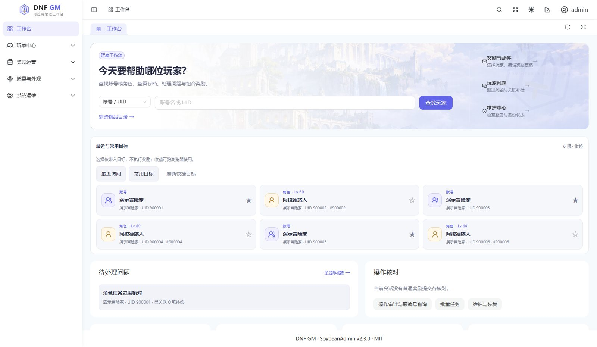
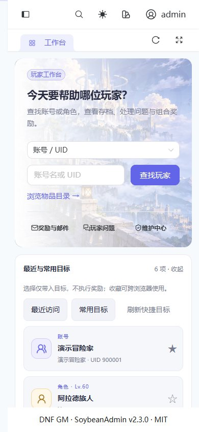
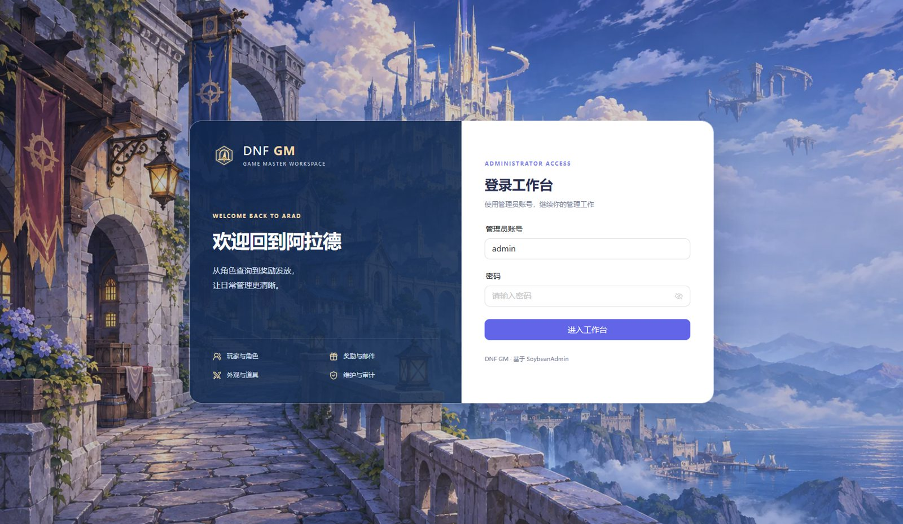
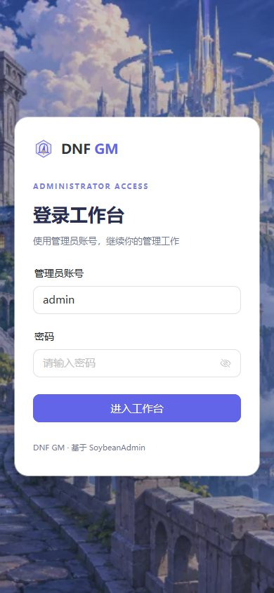
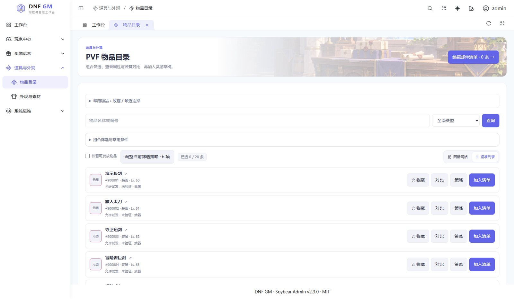
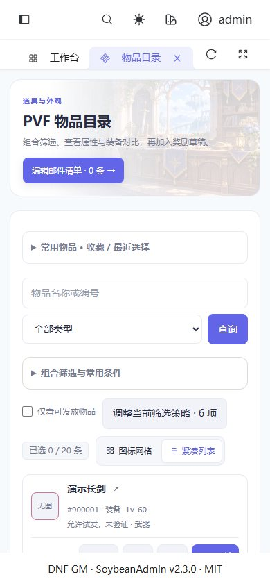
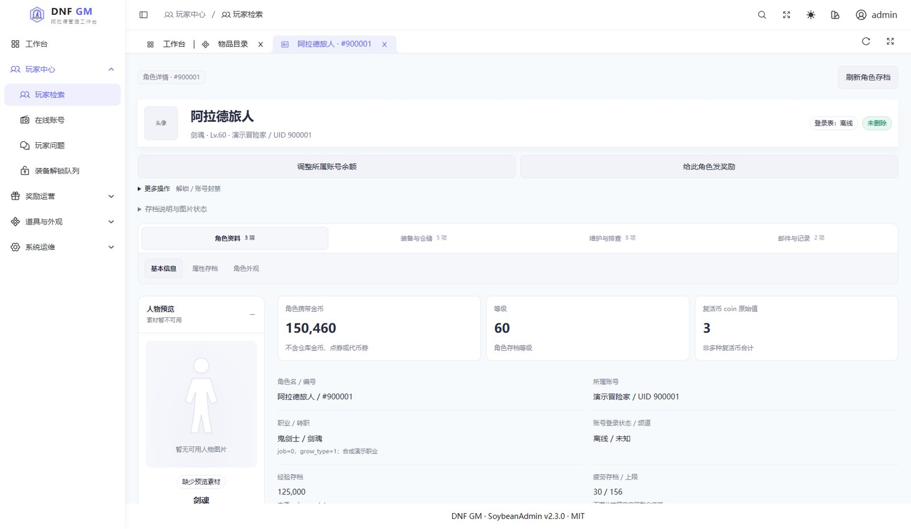
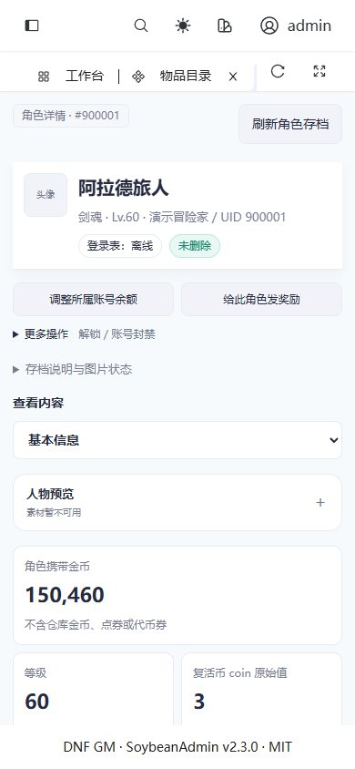
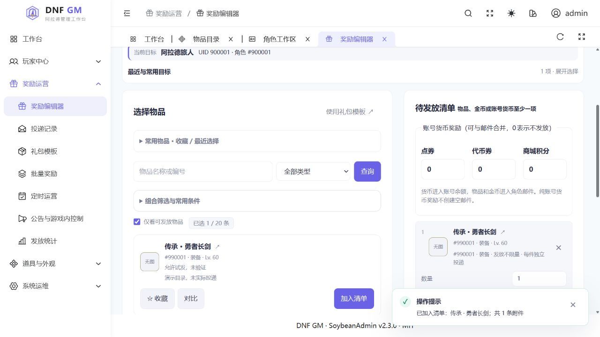
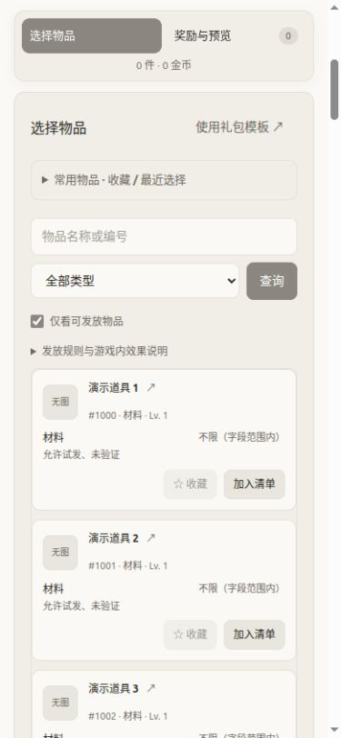

# 界面导览

[返回首页](../README.md) · [文档中心](README.md) · [部署指南](DEPLOYMENT.md)

> 图片更新于 2026-11-09。工作台、登录、物品目录与角色概览采用 v0.6.4；历史邮件流程图片另行标注。全部使用真实前端和本地合成 API、演示角色与虚构物品，没有连接生产 API，不是线上玩家数据或游戏内效果证明。

## 工作台：从玩家开始

浅色蓝紫主题、五组业务导航、工作页签和离线图标。首页包含搜索、最近与收藏目标、待处理问题与原操作查询，横幅提供三个常用入口。目标卡片使用账号／角色身份图标，不冒充精确职业头像。天空城背景为原创生成场景，见[背景素材说明](design/BACKGROUND-ART.md)。

## 登录页

桌面品牌区与表单放进同一个居中双栏卡片，共用上下边线；手机改为单列表单。背景按桌面／手机使用不同尺寸的 WebP，登录行为沿用原会话协议。

## 物品目录：网格与紧凑列表

统一选物可切换图标网格／紧凑列表，视图偏好按 PVF 在本机保存。组合筛选、收藏、对比、发放策略与加入清单保持独立入口。公会补给台横幅是原创装饰场景，按目录和奖励页面的业务路由加载；图中的武器和包裹不是实际可发放物品。截图里的合成物品保留“无图”，没有带入客户端图片。

## 角色概览：桌面侧栏、手机折叠

桌面左侧呈现静态人物预览，右侧查看金币、等级与资料；手机默认折叠人物区。图片依次使用可用的存档装扮首帧、默认职业站姿或头像，并标明来源；本组公开截图刻意使用无游戏素材的通用占位。角色资料、装备仓储、外观、维护与救援、奖励和记录分别查看，修改存档仍需要显式维护窗口。

## 历史邮件流程：v0.6.0

左侧搜索和选择物品，右侧编辑待发奖励。可组合角色邮件中的物品／金币，以及进入账号余额的点券／代币券／商城积分。纯账号货币奖励不会创建空邮件。

日常路径：**选账号和角色 → 加入清单／选模板 → 调整奖励 → 填原因 → 预览 → 确认一次 → 按原编号查询结果**。投递记录与游戏领取状态分开显示。

### 手机奖励编辑器

窄屏通过“选择物品／奖励与预览”切换；切换不卸载输入，不会清空清单。固定栏显示奖励摘要，列表使用卡片，物品名称、编号和加入按钮在同一可视区域。

最近与常用目标默认收起，避免抢占收件人区域；可选标题／正文及技术说明按需展开。操作原因仍直接显示，验证失败时定位到具体字段，不只在页顶提示。

v0.6.3 的[工作台](images/workbench-v063.jpg)和[登录页](images/login-v063.jpg)继续保留，便于对照历史布局；旧版角色截图及各文件版本见[来源记录](images/README.md)。

## 素材和证据边界

- 占位头像、“无图”物品是刻意保留的真实缺图状态，不用无关图片冒充匹配客户端素材。
- 公开仓库只有上述合成截图；真实 PVF、客户端 NPK、派生图片与玩家记录不随 Release 分发。
- 没有制作“已经成功领取”“技能效果生效”等无法由截图证明的宣传图。
- 本组截图来源、尺寸与更新方法见 [images/README.md](images/README.md)；图片功能和私有包安装见 [ASSETS.md](ASSETS.md)。
