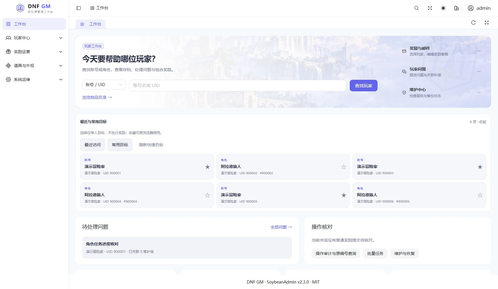
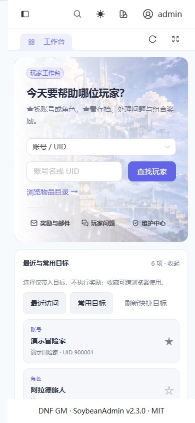
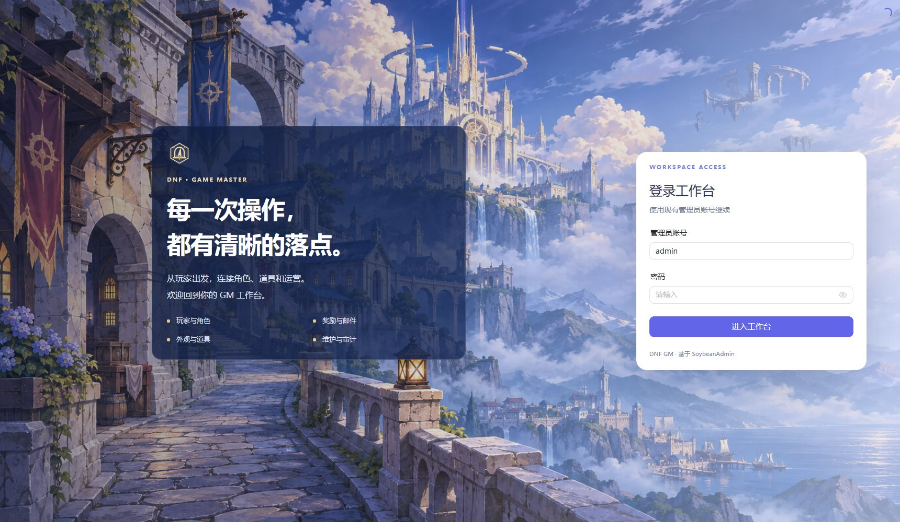
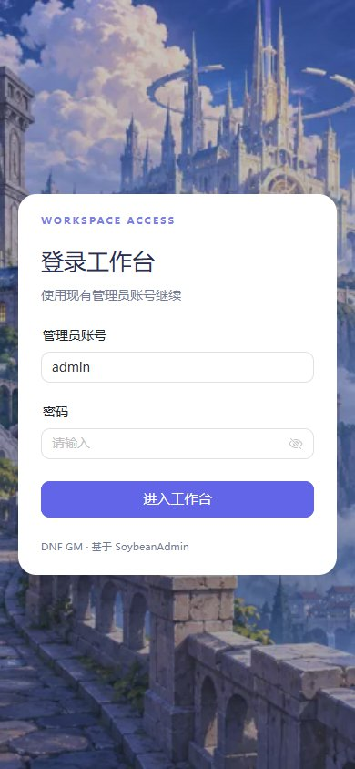
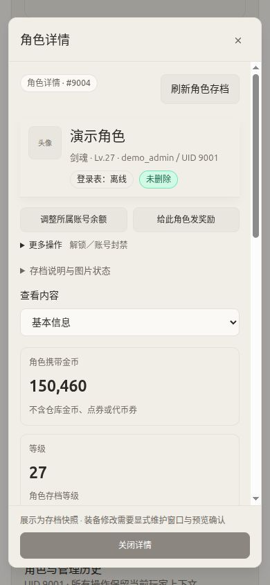

# 界面导览

[返回首页](../README.md) · [文档中心](README.md) · [部署指南](DEPLOYMENT.md)

> 图片更新于 2026-11-09。工作台与登录截图使用 v0.6.3，邮件／选物／角色截图保留 v0.6.0；均使用本地合成 API、演示角色与虚构物品，没有连接生产 API，不是线上玩家数据或游戏内效果证明。

## 工作台：从玩家开始

浅色蓝紫主题、五组业务导航、工作页签和离线图标。首页包含搜索、最近与收藏目标、待处理问题与原操作查询，横幅提供三个常用入口。天空城背景为原创生成场景，见[背景素材说明](design/BACKGROUND-ART.md)。

## 登录页

背景按桌面／手机使用不同尺寸的 WebP；表单保持清晰，登录行为沿用原会话协议。

## 1. 邮件奖励：桌面双栏

左侧搜索和选择物品，右侧编辑待发奖励。可组合角色邮件中的物品／金币，以及进入账号余额的点券／代币券／商城积分。纯账号货币奖励不会创建空邮件。

日常路径：**选账号和角色 → 加入清单／选模板 → 调整奖励 → 填原因 → 预览 → 确认一次 → 按原编号查询结果**。投递记录与游戏领取状态分开显示。

## 2. 手机选物：不再横向找按钮

窄屏通过“选择物品／奖励与预览”切换；切换不卸载输入，不会清空清单。固定栏显示奖励摘要，列表使用卡片，物品名称、编号和加入按钮在同一可视区域。

最近与常用目标默认收起，避免抢占收件人区域；可选标题／正文及技术说明按需展开。操作原因仍直接显示，验证失败时定位到具体字段，不只在页顶提示。

## 3. 手机角色：先看信息，再展开次要动作

角色详情是独立页面，保留账号余额与角色奖励两个高频入口，解锁、封禁和解封放入“更多操作”。概览、装备仓储、外观、成长技能、救援、奖励和记录按类别查看。修改角色存档仍要显式维护窗口；工作页签不改变提交约束。

## 素材和证据边界

- 占位头像、“无图”物品是刻意保留的真实缺图状态，不用无关图片冒充匹配客户端素材。
- 公开仓库只有上述合成截图；真实 PVF、客户端 NPK、派生图片与玩家记录不随 Release 分发。
- 没有制作“已经成功领取”“技能效果生效”等无法由截图证明的宣传图。
- 本组截图来源、尺寸与更新方法见 [images/README.md](images/README.md)；图片功能和私有包安装见 [ASSETS.md](ASSETS.md)。
