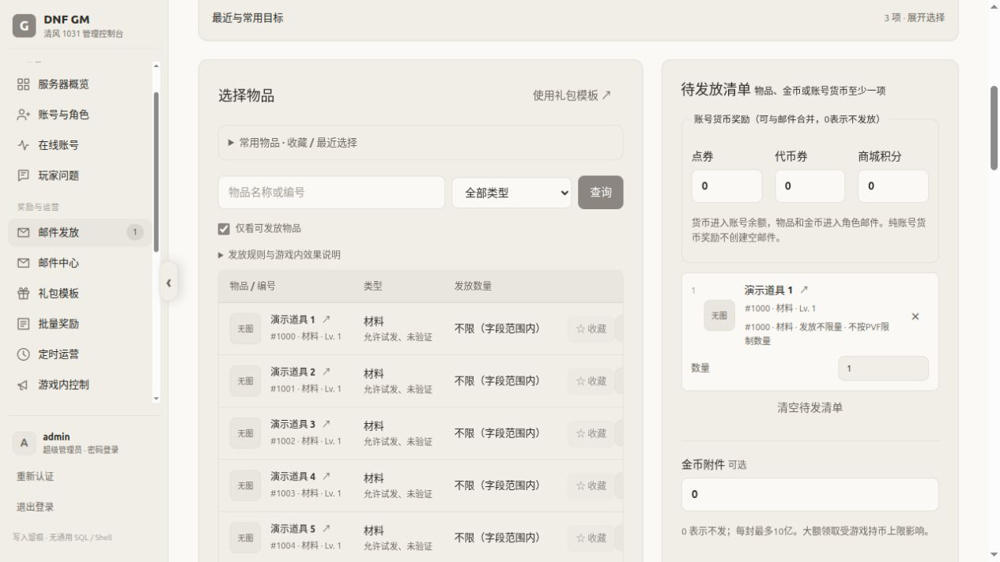

# v0.4.0 · 中文 GM 工作台与文档焕新

2026-11-07 · llnut/dnf 清风1031／MySQL 5.7 专用适配版

本版将 `v0.2.2` 之后的当前源码能力整理为可下载版本，同时重写项目首页、功能展示、部署及开发导航。**不是仅给旧0.2.2换文档，也不是游戏服务器一键整合包。发布GitHub版本不代表私人服务器已升级。**

## 主要变化

- **图文首页与文档中心**：真实前端配合合成数据的桌面邮件、手机选物和角色详情截图；首次安装、已有实例升级、开发及专题手册分开导航。
- **紧凑操作体验**：手机邮件“选择物品／奖励与预览”切换、固定摘要栏、物品卡片、默认收起的最近目标、角色“更多操作”、隐藏错误自动展开定位；桌面保留双栏。
- **奖励与运营**：账号三类货币、物品及10亿金币邮件、版本化礼包、邮件记录、名单／筛选／批量奖励、持久任务和定时计划。道具数量1–2,147,483,647，不恢复PVF堆叠值限量；特殊类型仍需适配。
- **角色与装备**：装备语义前后对照、附魔检索；改名、位置救援、疲劳、等级／经验、SP／TP、同基础职业转职／觉醒、PvE技能重置和单任务槽修复。存档写入保持显式维护窗口。
- **运维与审计**：网页能力策略、问题工作台、发放统计、版本及插件证据、告警、管理库在线备份与恢复核验链路。
- **发布流程**：统一包／网页／就绪接口版本为0.4.0；新增固定标签的源码包、预构建静态网页及SHA-256清单流程。不增加游戏业务或数据库迁移。

## 界面预览



[更多手机截图与说明](https://github.com/Wuse777/llnut-dnf-gm/blob/v0.4.0/docs/SCREENSHOTS.md) · [功能／手册导航](https://github.com/Wuse777/llnut-dnf-gm/blob/v0.4.0/docs/README.md)

## 下载附件

| 附件 | 用途 |
| --- | --- |
| `llnut-dnf-gm-0.4.0-source.tar.gz` | 标签源码与完整文档，继续在维护电脑构建 |
| `llnut-dnf-gm-0.4.0-web.tar.gz` | 同版 `web/dist/` 与 `SOURCE_REVISION`，不包含后端／wheels |
| `SHA256SUMS` | 上述两个附件的SHA-256完整性校验 |

```bash
# 将两个附件和校验文件放在同一目录后执行
sha256sum --check --strict SHA256SUMS
```

**附件都不是可直接交给 install.sh 的完整离线安装目录。** 源码可在Python3.12、Node24.15+的24.x环境通过 `tools/build_release.sh` 构建；目标OS／架构必须与wheels一致。所有附件均不含游戏服务端／客户端、PVF、NPK、真实索引、图片包、私有配置或玩家数据。

## 安装与升级

- [完整部署指南](https://github.com/Wuse777/llnut-dnf-gm/blob/v0.4.0/docs/DEPLOYMENT.md)：Linux＋systemd、Python3.12、现有清风1031与MySQL5.7；隧道起步，HTTPS可选。
- 管理库需要 **001–016**；从0.2.x升级必须备份并使用 `deploy/upgrade-release.py` 补齐迁移／精确授权，**不要重复 provision**。
- 保留外部索引与PVF绑定，检查新包没有会覆盖外部数据的旧内嵌索引。现有配置与新权限均需核对，不以网页按钮存在当作已适配。
- 安装只操作GM组件；游戏存档维护另走明确开窗流程，不重启共享Docker、mihomo或cliproxyapi。
- 应用回滚不撤回已发货币／已领物品，不删除审计与防重记录；不以整库恢复取消单笔奖励。

## 验证与已知限制

本轮文档／发布批次只做文档链接及图片检查、版本一致性、两项版本相关接口检查、前端类型检查／构建、发布脚本语法和归档核对；**不重跑全量回归，不连接生产库写玩家数据，不做新服务器端到端安装或客户端验收**。既有交互43项检查属于2026-11-06，证据保留在对应报告中。

构建现有主JS块仍有超过500kB提示，未声称完成拆包优化。已实现能力不等于全部游戏内行为验收通过；在线消费、邮件领取、转职／技能等效果需部署者按实际版本验证。

缺少匹配客户端图片仍保留，公开截图不带游戏素材；可靠指定玩家系统消息未接通。插件证据页不是0CD／无敌控制器。没有任意SQL／Shell、多管理员权限体系或玩家兑换码网站。

[完整变更记录](https://github.com/Wuse777/llnut-dnf-gm/blob/v0.4.0/CHANGELOG.md) · [实施台账](https://github.com/Wuse777/llnut-dnf-gm/blob/v0.4.0/docs/ROADMAP-IMPLEMENTATION.md) · [安全说明](https://github.com/Wuse777/llnut-dnf-gm/blob/v0.4.0/SECURITY.md)
